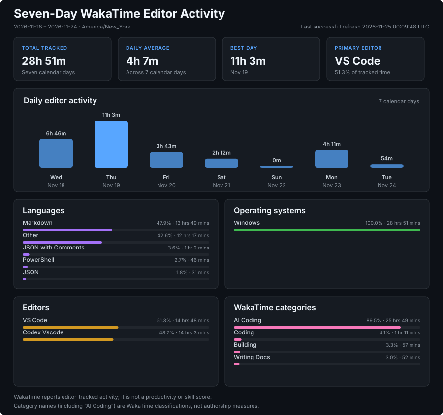

# Chad Reesey | reesey275 | Mr. Potato

> [!NOTE]
> Platform & Infrastructure Engineering | DevSecOps | Systems Automation

## Professional Summary

United States Air Force veteran and founder and CEO of The Angry Gamer Show
Productions, LLC (TAGS), a veteran-owned and operated Florida company.
My focus is platform and infrastructure engineering, DevSecOps, and systems
automation, grounded in more than 25 years of hands-on computing and
infrastructure experience. Professional work beginning in 2007 includes
systems administration, Windows scripting, SharePoint portal development,
systems integration, and multi-site technology deployment.

I currently operate the TAGS build phase as an **AI-assisted solo human operator**.
My active-duty service ran from August 10, 2000, through March 28, 2012;
honorable service.

See my [résumé](resume/resume.md#professional-experience) for professional
responsibilities, military service, community infrastructure, and nonprofit
leadership, with [credential and training details](resume/resume.md#earned-certifications)
kept separate from experience.

## 🎯 Featured Projects

### [TAGS Ecosystem](docs/PROJECTS/TAGS-Ecosystem.md)

**Overview:** The current TAGS build phase brings together software,
automation, documentation, and infrastructure projects operated under The
Angry Gamer Show Productions, LLC.

**Stack:** Python • TypeScript • Shell (POSIX/Bash) • Docker • GitHub Actions

**Operating model:** Founder and CEO; AI-assisted solo human operator during
the current build phase. Delivered work is distinguished from plans and
experiments in the project overview. See the
[reusable CI and documentation implementations](docs/PROJECTS/TAGS-Ecosystem.md#reusable-ci-and-documentation-evidence)
for concrete public examples.

---

### [DevOnboarder](docs/PROJECTS/DevOnboarder.md)

**Overview:** Multi-service onboarding-automation project with Discord, web,
and CI/CD components.

**Stack:** Python • Shell (POSIX/Bash) • FastAPI • Discord API • GitHub Actions

**Public components:** Onboarding workflows, web and API services, Discord
integration, documentation checks, and GitHub Actions automation.

---

### [SquirrelFocus](docs/PROJECTS/SquirrelFocus.md) | [Repository](https://github.com/reesey275/squirrelfocus)

**Overview:** Python command-line productivity and reflection toolkit for
short work-session notes and supporting documentation.

**Stack:** Python • Shell (POSIX/Bash)

---

### [Whisper Project](docs/PROJECTS/WhisperProject.md) | [Repository](https://github.com/reesey275/whisper-project)

**Overview:** Transcription utilities with local, Docker, and optional cloud-API
processing paths, including batch and optional GPU workflows. Local processing
is available when cloud services are not desired.

**Stack:** Python • Whisper • Docker • Optional cloud API

---

### Personal tooling

- [spotify-dev-toolkit](https://github.com/reesey275/spotify-dev-toolkit) — Spotify playlist tooling with an Express
  backend, browser interface, and Python export utility.
- [tags-workflows](https://github.com/theangrygamershowproductions/tags-workflows) — public reusable GitHub Actions
  workflows for organization repositories.
- [core-instructions](docs/PROJECTS/core-instructions.md) _(private repository)_ — documentation project for engineering
  policies, review processes, security guidance, and agent instructions.

## Engineering Capabilities & Experience

Current evidence, professional experience, and qualifications are distinguished
below. A dependency or optional service does not establish a capability by itself.

### Demonstrated Current Capabilities

These capabilities are supported by current project work or established
professional experience. Supporting evidence and historical context are
linked where available.

#### Systems & Infrastructure

[![Windows Administration][windows-badge]][windows-evidence]
[![Linux Administration][linux-badge]][linux-evidence]
[![Docker and Compose][docker-compose-badge]][docker-evidence]

#### Automation & Engineering Governance

[![PowerShell][powershell-badge]][powershell-evidence]
[![Shell and Bash][bash-badge]][shell-evidence]
[![GitHub Actions and CI Governance][ci-governance-badge]][ci-evidence]
[![Documentation, Validation, and Engineering Governance][governance-badge]][governance-evidence]

#### Software & APIs

[![Python][python-badge]][python-evidence]
[![JavaScript and Node.js][js-node-badge]][js-node-evidence]
[![TypeScript][ts-badge]][typescript-evidence]
[![API Development][api-badge]][api-evidence]

[Explore projects and supporting evidence](docs/PROJECTS/TAGS-Ecosystem.md).

### Professional & Historical Systems Experience

Experience across professional roles; not a claim of current daily use.
These technologies are not additional demonstrated-current capability badges.

| Area | Professional and historical experience |
| --- | --- |
| Enterprise Systems |       |
| Virtualization |     |
| Networking & Endpoint Operations |     |
| Identity & Access |    |

[Professional history & responsibilities](resume/resume.md#professional-and-historical-systems-experience) ·
[Technology exposure & classifications](docs/STACK_HISTORY.md)

### Earned Credentials & Continuing Development

[![AWS Certified Cloud Practitioner — Certified][aws-badge]][aws-evidence]

Issued November 17, 2026. Foundational cloud knowledge; separate from production
AWS experience. [Credential details](resume/resume.md#earned-certifications).

[![Java — Developing Proficiency][java-badge]][java-evidence]

Completed WGU Java Fundamentals (D286) and Java Frameworks (D287).
Java remains current learning; coursework does not imply production Java experience.

- **WGU B.S. Software Engineering** — currently enrolled; also completed
  Hardware and Operating Systems Essentials (D386).
- **WGU Front-End Developer micro-credential** — awarded April 15, 2026.

See [certification and coursework details](resume/resume.md#education-and-recognition)
for completion dates, earned CUs, pending D282 credit, and leadership
recognition; [professional development](resume/resume.md#professional-development)
covers additional training.

[python-badge]: https://img.shields.io/badge/Python-Demonstrated-3776AB?logo=python&style=flat
[python-evidence]: https://github.com/reesey275/squirrelfocus
[js-node-badge]: https://img.shields.io/badge/JavaScript%20%2F%20Node.js-Demonstrated-5FA04E?logo=nodedotjs&style=flat
[js-node-evidence]: https://github.com/reesey275/spotify-dev-toolkit
[ts-badge]: https://img.shields.io/badge/TypeScript-Demonstrated-3178C6?logo=typescript&style=flat
[typescript-evidence]: docs/STACK_HISTORY.md#demonstrated-current-capabilities
[api-badge]: https://img.shields.io/badge/API%20Development-FastAPI%20%7C%20Express%20%7C%20REST%20%7C%20OAuth-2563EB?style=flat
[api-evidence]: docs/PROJECTS/TAGS-Ecosystem.md#api-development-evidence
[bash-badge]: https://img.shields.io/badge/Shell%20%2F%20Bash-Automation-4EAA25?logo=gnubash&style=flat
[shell-evidence]: https://github.com/reesey275/whisper-project
[powershell-badge]: https://img.shields.io/badge/PowerShell-Automation-5391FE?logo=powershell&style=flat
[powershell-evidence]: docs/PROJECTS/SquirrelFocus.md
[docker-compose-badge]: https://img.shields.io/badge/Docker%20%2F%20Compose-Delivery-2496ED?logo=docker&style=flat
[docker-evidence]: docs/PROJECTS/WhisperProject.md
[ci-governance-badge]: https://img.shields.io/badge/GitHub%20Actions-CI%20Governance-2088FF?logo=githubactions&style=flat
[ci-evidence]: https://github.com/theangrygamershowproductions/tags-workflows
[windows-badge]: https://img.shields.io/badge/Windows-Administration-0078D4?logo=windows&style=flat
[windows-evidence]: resume/resume.md#professional-and-historical-systems-experience
[linux-badge]: https://img.shields.io/badge/Linux-Administration-FCC624?logo=linux&style=flat
[linux-evidence]: docs/STACK_HISTORY.md#operating-systems
[governance-badge]: https://img.shields.io/badge/Documentation%20%7C%20Validation-Engineering%20Governance-334155?style=flat
[governance-evidence]: https://github.com/theangrygamershowproductions/tags-workflows
[aws-badge]: https://img.shields.io/badge/AWS%20Certified%20Cloud%20Practitioner-Certified-b78103?style=flat
[aws-evidence]: resume/resume.md#earned-certifications
[java-badge]: https://img.shields.io/badge/Java-Developing%20Proficiency-ED8B00?logo=openjdk&style=flat
[java-evidence]: resume/resume.md#western-governors-university
[github-stats]: ./profile/github-stats.svg
[top-languages]: ./profile/top-languages.svg
[profile]: https://github.com/reesey275

## Supporting Project and Systems Exposure

Current or recent project work also includes Fastify; Discord API and MCP SDK
integration; React, Vite, Tailwind CSS, and shadcn/ui; and Traefik, Cloudflare
Tunnel, and TrueNAS SCALE. Supporting formats include Markdown, YAML, JSON,
SQL, HTML, and CSS.

Identity, data, and platform work includes OAuth2, JWT, RBAC, Active Directory,
secret management, PostgreSQL, Redis, and SQLite; virtualization; patching,
troubleshooting, service reliability, and infrastructure documentation. MySQL
and Supabase are historical, experimental, or project exposure rather than
demonstrated core capabilities.

### AI-Assisted Engineering and Orchestration Tooling

Engineering tooling and workflow exposure includes OpenAI/ChatGPT and Custom
GPT workflows, GitHub Copilot, Codex-assisted planning, MCP servers and SDK
integration, and agent-assisted and prompt-driven workflows. These tools
support planning, implementation, documentation, review, and orchestration;
their use is not standalone proof of software-engineering proficiency or
authorship.

**[📖 Stack History & Systems Exposure](docs/STACK_HISTORY.md)** — Selected,
non-exhaustive historical technology exposure (historical breadth, not a claim
of current daily usage)

## 🧭 Engineering Philosophy and Working Practices

I build thinking systems: **visible learning → doctrine → automation**.
Structure, accountability, correctness, documentation, and automation guide
the work. If a system requires tribal knowledge to function, it is already a
liability.

- Written context before decisions; scoping and discovery when requirements
  are still forming
- Observable, repeatable, resilient systems
- Deterministic CI, linting, documentation validation, and reproducible builds
- Clear standards, direct feedback, and auditability

Read the [engineering philosophy](PHILOSOPHY.md),
[learning journal](docs/Journal_Index.md), and
[after-action reports](docs/AAR_Index.md) for methodology and reflection.

## 📊 GitHub Stats

- **Demonstrated development languages:** Python • JavaScript • TypeScript •
  Shell/Bash • PowerShell
- **Supporting formats:** SQL • Markdown • YAML • JSON • HTML/CSS
- **Active Learning:** Java
- **Organization:** [The Angry Gamer Show Productions](https://github.com/theangrygamershowproductions)

### GitHub Contribution Activity

Note: Contribution activity reflects a current build phase operated by one human
using AI-assisted tools. It does not imply sole authorship of every historical
commit, dependency, generated output, or third-party component.

These cards use public GitHub REST data only. Code composition is calculated
from GitHub Linguist source-code bytes across public, non-fork projects,
excludes this profile repository, and is not a proficiency ranking.

[![GitHub Stats][github-stats]][profile]

[![Public Project Code Composition][top-languages]][profile]

## 📈 Seven-Day Editor Activity

WakaTime reports editor-tracked activity from the last successful
seven-calendar-date window. It is workflow context rather than a measure of
productivity, skill, or authorship. Labels such as "AI Coding" are WakaTime
classifications; they do not identify who or what authored the work. If a
refresh fails, the last successful
snapshot and its timestamp remain visible. The most recent date may contain a
partial day at refresh time. Project names are intentionally omitted from the
public output.

<!--START_SECTION:waka-->

View seven-day editor activity data

- **Time Zone:** America/New\_York
- **Reporting Window:** 7 inclusive calendar dates (latest may be partial)
- **Date Range:** 2026-11-12 - 2026-11-18
- **Total Tracked:** 31 hrs 23 mins
- **Daily Average:** 4 hrs 29 mins
- **Best Day:** 2026-11-13 (11 hrs 10 mins)

### Languages

- Markdown: 10 hrs 23 mins (33.12%)
- Other: 9 hrs 39 mins (30.77%)
- PowerShell: 5 hrs 9 mins (16.41%)
- JSON with Comments: 4 hrs 39 mins (14.86%)
- TOML: 1 hr 26 mins (4.57%)

### Editors

- Codex Vscode: 18 hrs 16 mins (58.19%)
- VS Code: 12 hrs 46 mins (40.67%)
- Codex Exec: 21 mins (1.14%)

### Operating Systems

- Windows: 30 hrs 34 mins (97.39%)
- Linux: 25 mins (1.33%)
- WSL: 24 mins (1.28%)

### Categories

- AI Coding: 24 hrs 34 mins (78.29%)
- Coding: 4 hrs 13 mins (13.45%)
- Writing Docs: 2 hrs 12 mins (7.02%)
- Building: 23 mins (1.24%)

_Category names, including "AI Coding," are WakaTime classifications and do not measure authorship._

_Last successful refresh: 2026-11-19 00:10:12 UTC_
<!--END_SECTION:waka-->

## 🌐 Connect With Me

- **🏢 Company:** [The Angry Gamer Show Productions](https://theangrygamershow.com)
- **💼 LinkedIn:** [in/chad-reesey](https://linkedin.com/in/chad-reesey)
- **🐦 Twitter/X:** [@reesey275](https://x.com/reesey275)
- **📘 Facebook:** [Reesey275](https://facebook.com/Reesey275)
- **📸 Instagram:** [reesey275](https://instagram.com/reesey275)
- **📧 Email:** [reesey.chad@outlook.com](mailto:reesey.chad@outlook.com)
- **📍 Location:** Space Coast, Florida, United States

## 📋 Resources

- [📄 Resume](resume/resume.md) — Professional background and experience
- [🧠 Philosophy](PHILOSOPHY.md) — Core methodology and approach
- [📚 Journal Index](docs/Journal_Index.md) — Learning documentation
- [🔍 AAR Index](docs/AAR_Index.md) — After Action Reports

> _"We practice in public so others can perform in peace."_

**Availability:** Open to serious, role-specific professional opportunities
and professionally presented inquiries.
